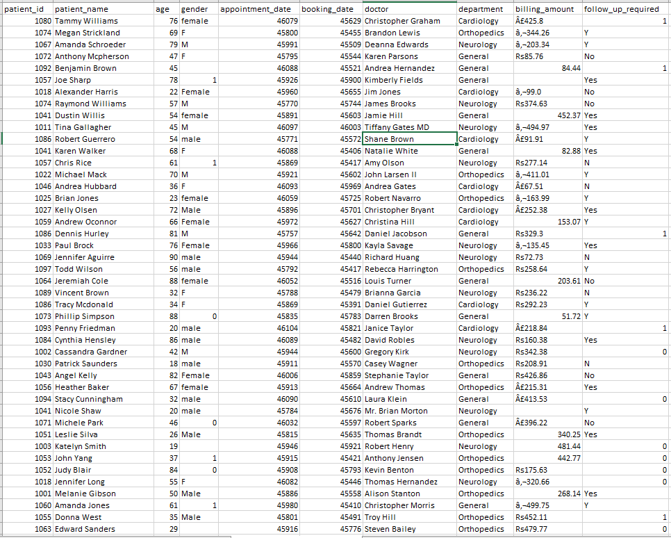
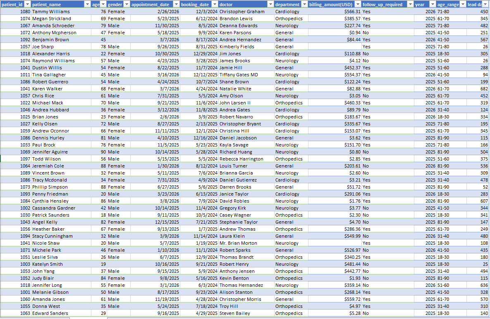
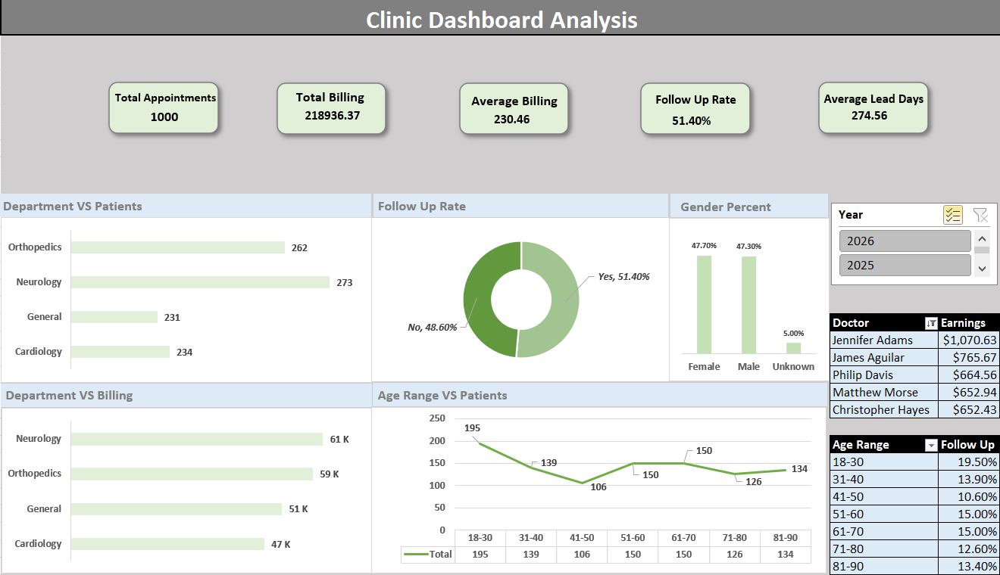

# Clinic Appointment and Billing Analysis Project

## Project Overview

This project focuses on cleaning, transforming, and analyzing clinic appointment and billing data using Power Query and Microsoft Excel. The project transforms a messy dataset into a clean, structured dataset and an interactive dashboard to analyze appointments, billing, patient demographics, department performance, doctor earnings, and follow-up rates.

## Data Source and Tools

- **Dataset:** [Messy Clinic Appointments Dataset — Kaggle](https://www.kaggle.com/datasets/nudratabbas/messy-clinic-appointments-dataset)
- **Data Cleaning:** Microsoft Excel Power Query
- **Data Analysis and Visualization:** Microsoft Excel, PivotTables, PivotCharts, and slicers

## Project Workflow

1. Obtained the messy dataset from Kaggle.
2. Cleaned and transformed the data using Power Query.
3. Created additional columns for Year, Age Range, and Lead Days.
4. Analyzed the data using PivotTables and PivotCharts.
5. Developed an interactive Excel dashboard with a Year slicer.
6. Identified key findings from the dashboard.

## 1. Messy Dataset

The original dataset contained inconsistent values that required cleaning and standardization before analysis.

## 2. Cleaned Dataset

The dataset after cleaning, standardization, and transformation in Power Query.

## 3. Data Cleaning and Transformation

The following steps were performed using Power Query:

- Cleaned and trimmed text values.
- Standardized inconsistent gender values.
- Converted monetary amounts into USD for consistent billing analysis.
- Standardized follow-up values: `1 = Yes`, `0 = No`.
- Standardized gender values: `1 = Male`, `0 = Female`.
- Created a **Year** column for year-based analysis.
- Created an **Age Range** column to group patients by age.
- Created a **Lead Days** column by calculating the difference between the booking date and appointment date.

## 4. Interactive Excel Dashboard

After cleaning and transforming the data, an interactive dashboard was created in Microsoft Excel to present key performance indicators and analyze appointment and billing trends.

## 5. Key Findings from the Dashboard

The following questions were explored using the dashboard. The findings will be added after reviewing the results.

1. **Total Appointments:** How many appointments are recorded in the dataset?

   **Finding:** 1000.

2. **Total Billing:** What is the total billing amount in USD?

   **Finding:** 218936.37.

3. **Average Billing:** What is the average billing amount per appointment?

   **Finding:** 230.46.

4. **Follow-up Rate:** What percentage of appointments require follow-up?

   **Finding:** 51.40%.

5. **Average Lead Days:** What is the average number of days between booking and appointment?

   **Finding:** 274.56 days.

6. **Department vs. Patients:** Which department handles the highest number of appointments?

   **Finding:** Neurology.

7. **Department vs. Billing:** Which department generates the highest total billing?

   **Finding:** Neurology.

8. **Gender Distribution:** What percentage of patients are male and female?

   **Finding:** Male - 47.30% and Female - 47.70%.

9. **Age Range vs. Patients:** Which age group has the highest number of patients?

   **Finding:** 18-30.

10. **Doctor Earnings:** Which doctor generates the highest total billing?

    **Finding:** Jennifer Adams.

11. **Top Five Doctors:** Who are the five highest-earning doctors?

    **Finding:** Jennifer Adams, James Aguilar, Philip Davis, Matthew Morse, Christopher Hayes.

12. **Age Range vs. Follow-up Rate:** Which age group has the highest follow-up rate?

    **Finding:** 18-30.

13. **Yearly Comparison:** How do appointment volumes differ between 2025 and 2026?

    **Finding:** **Finding:** In 2025, there were 760 appointments, compared with 240 appointments in 2026. Appointment volume decreased by 520 appointments (68.42%) from 2025 to 2026.

14. **Billing Comparison by Year:** How does total billing differ between 2025 and 2026?

    **Finding:** **Finding:** Total billing was $160,703.48 in 2025 and $58,232.89 in 2026. Total billing decreased by $102,470.59 (63.76%) from 2025 to 2026.

## 6. Dashboard Interactivity

The dashboard includes a **Year slicer** with options for 2025 and 2026.

- Select a year to filter the dashboard.
- View updated KPI values, PivotTables, and PivotCharts based on the selected year.
- Compare appointment volumes, billing performance, and follow-up patterns across years.
- Use the different charts to explore department performance, doctor earnings, and patient demographics.

The slicer is connected to the dashboard's PivotTables and PivotCharts, allowing the relevant visualizations to update together when a year is selected.

## 7. Conclusion

This project demonstrates the process of transforming messy data into meaningful business insights using Power Query and Microsoft Excel. It combines data cleaning, transformation, analysis, and interactive visualization to explore clinic appointment patterns, billing performance, and patient follow-up behavior.

**Credits:** The original dataset was obtained from [Kaggle — Messy Clinic Appointments Dataset](https://www.kaggle.com/datasets/nudratabbas/messy-clinic-appointments-dataset). The dataset was used as the foundation for the cleaning, analysis, and dashboard development presented in this project.

## Author

**Name:** Baharul Islam

**LinkedIn:** [Add your LinkedIn profile URL](www.linkedin.com/in/baharul9096)
